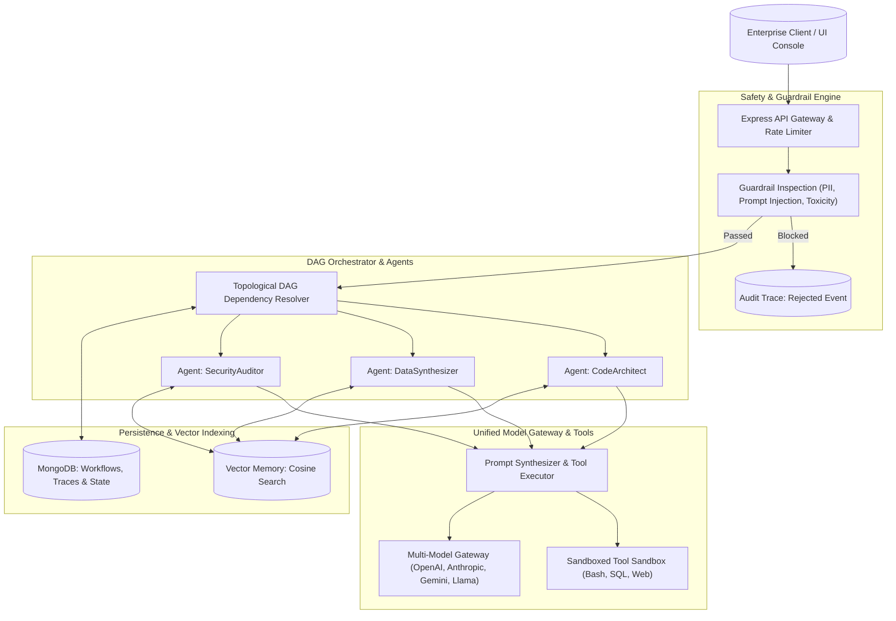

# NeuroFlow-AI 🧠⚡

> **Enterprise Autonomous Agent Orchestrator, Multi-Model DAG Workflows, Vector Semantic Memory & Safety Guardrails Platform.**

[](https://opensource.org/licenses/MIT)
[](https://nodejs.org/)
[](https://www.docker.com/)
[](#test-suites)
[](CHANGELOG.md)

NeuroFlow-AI is a fault-tolerant orchestration platform designed for managing complex, multi-step LLM autonomous agent systems. It features directed acyclic graph (DAG) dependency scheduling, real-time cosine similarity episodic vector memory, deterministic sandboxed tool calling, and strict security guardrails with prompt injection shielding and PII anonymization.

---

## 🏛️ System Architecture



---

## 🚀 Key Architectural Features

1. **Topological DAG Workflow Engine**: Executes intricate multi-agent dependencies with zero deadlocks using Kahn's topological sort algorithm and asynchronous parallel branching.
2. **Deterministic Tool Sandboxing**: Isolates and validates tool invocations (SQL executors, math evaluation, dynamic web retrieval) with strict schema gating and timeout controls.
3. **High-Precision Vector Episodic Memory**: Native vector indexing with cosine similarity scoring, temporal relevance decay, and fast semantic recall across agent sessions.
4. **Zero-Trust Safety Guardrails**: Multi-tier content screening that inspects prompts and tool outputs for adversarial injections, PII disclosures, and unauthorized tool calls.
5. **Multi-Model Provider Agnostic**: Seamlessly switches execution nodes between OpenAI GPT-4o, Anthropic Claude 3.5 Sonnet, Google Gemini 1.5 Pro, and self-hosted open-weights models.
6. **Complete Agent Ops Dashboard**: React 18 console providing live DAG execution visualizers, active agent metrics, token expenditure counters, and safety audit streams.

---

## 📦 Directory Structure

```text
neuroflow-ai/
├── client/                     # React 18 Agent Ops Console
│   ├── public/
│   │   └── index.html
│   └── src/
│       ├── components/         # Visual DAG, Metrics, Terminal Logs, Guardrails
│       ├── services/           # REST API client
│       ├── utils/              # Status badge formatters
│       ├── App.jsx             # Main interactive application dashboard
│       ├── App.css             # Enterprise dark-themed styling
│       └── index.js            # React root mount
├── server/                     # Core Backend & Orchestration Engine
│   ├── config/                 # Database, providers & execution constants
│   ├── controllers/            # Agent, Workflow, Memory, Guardrails, Analytics
│   ├── middleware/             # API Key auth, rate limiting, error handlers
│   ├── models/                 # Mongoose schemas (Agent, Workflow, Vector, etc.)
│   ├── routes/                 # Express REST endpoint declarations
│   ├── services/               # DAG solver, Prompt synthesizer, Vector engine
│   ├── tests/                  # 7 Comprehensive Automated Test Suites
│   ├── utils/                  # Structured logger & agent seeder
│   └── server.js               # Application entry point & cluster setup
├── Dockerfile                  # Multi-stage production build
├── docker-compose.yml          # Containerized MongoDB, Redis & API stack
├── CHANGELOG.md                # Detailed release notes
└── package.json                # Project dependencies & scripts
```

---

## ⚡ Quick Start

### Prerequisites
- Node.js >= 18.0.0
- MongoDB >= 6.0
- Docker & Docker Compose (optional)

### Local Development Setup

```bash
# 1. Clone repository
git clone https://github.com/developertdsl-prog/neuroflow-ai.git
cd neuroflow-ai

# 2. Install root dependencies
npm install

# 3. Configure environment variables
cp .env.example .env

# 4. Seed pre-configured autonomous agents
npm run seed

# 5. Run automated test suites
npm test

# 6. Launch development server with client
npm run dev
```

---

## 📡 REST API Reference

| Endpoint | Method | Description |
| :--- | :--- | :--- |
| `GET /api/v1/ping` | GET | Lightweight health check and system status |
| `GET /api/v1/agents` | GET | Retrieve all registered autonomous agent profiles |
| `POST /api/v1/agents` | POST | Register a new autonomous agent definition |
| `POST /api/v1/workflows/execute` | POST | Trigger a DAG multi-agent workflow execution |
| `GET /api/v1/workflows/:id` | GET | Fetch live execution trace and topological node states |
| `POST /api/v1/memory/search` | POST | Semantic nearest-neighbor vector memory search |
| `POST /api/v1/guardrails/screen`| POST | Run safety and prompt-injection screening on text |
| `GET /api/v1/analytics/summary` | GET | Real-time token consumption, latency, and success metrics |

---

## 🧪 Automated Test Suites

NeuroFlow-AI is covered by 7 unit, integration, and end-to-end test suites:

- `dagOrchestrator.test.js`: Cycle detection, topological node sequencing, and parallel dependency resolution.
- `guardrailEngine.test.js`: PII masking, malicious prompt injection rejection, and content pass-through.
- `vectorMemory.test.js`: Cosine similarity computation, high-dimensional vector search, and memory recall.
- `toolExecutor.test.js`: Sandboxed tool execution, JSON argument validation, and timeout protection.
- `workflowExecution.test.js`: Workflow lifecycle transitions from PENDING through COMPLETED and FAILED.
- `promptSynthesizer.test.js`: Variable template interpolation and system prompt compilation.
- `e2eAgentWorkflow.test.js`: Full end-to-end agent task invocation from HTTP request to synthesized response.

---

## 📄 License
This project is licensed under the MIT License - see the [LICENSE](LICENSE) file for details.
